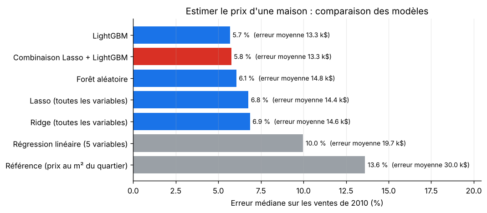
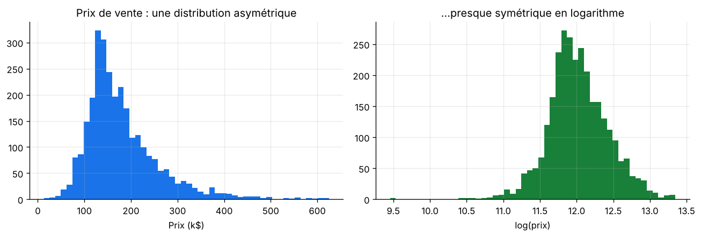
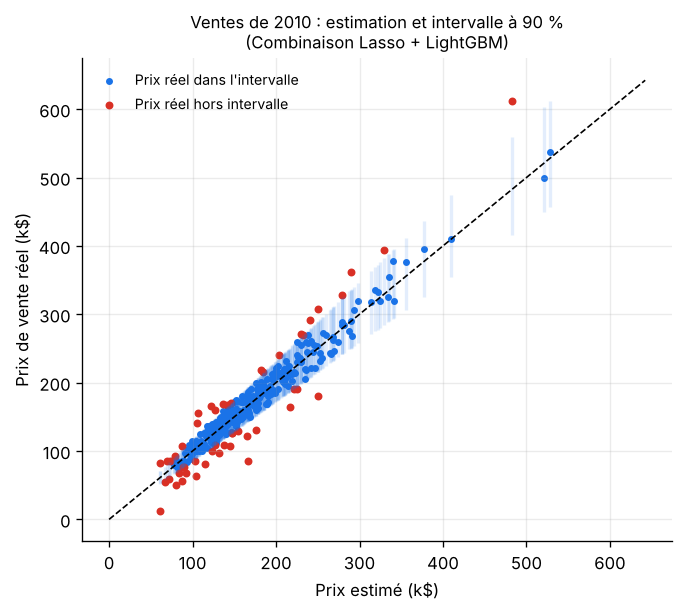
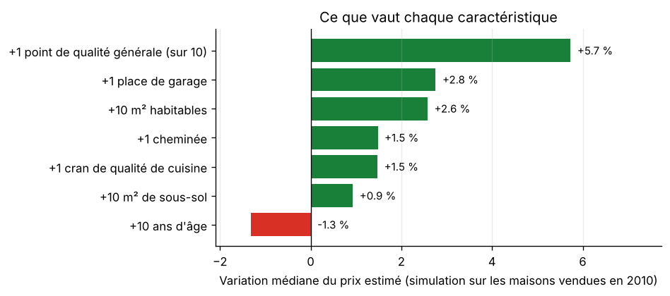
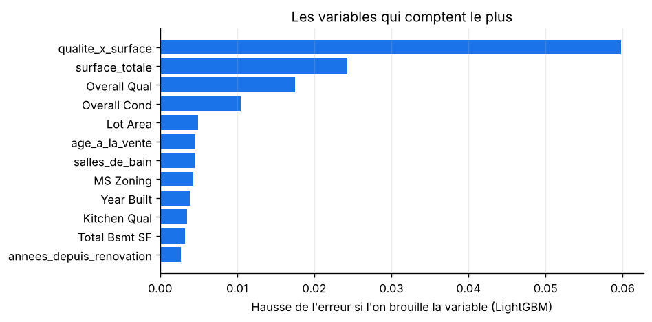
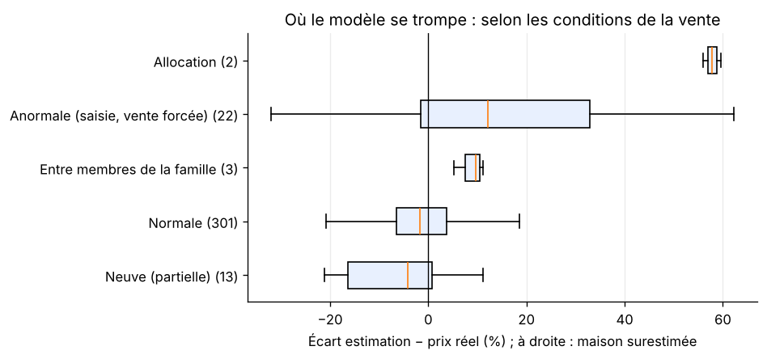

<div align="center">

# 🏠 Estimation du prix de l'immobilier

**Estimer le prix de vente d'une maison, avec une fourchette honnête, et expliquer ce qui fait sa valeur.**

Régression · 7 modèles comparés · intervalles de prix par prédiction conforme · simulation « et si… ? »


</div>

---

## 🎯 Le problème

Un agent immobilier, une banque qui accorde un prêt ou un particulier qui vend : tous ont besoin d'une **estimation fiable**
du prix d'un bien. Et une estimation seule ne suffit pas : il faut savoir **à quel point on peut s'y fier**.

**Données** : les 2 930 ventes de maisons de la ville d'Ames (Iowa, États-Unis) entre 2006 et 2010, décrites par 80 caractéristiques
(surface, qualité, quartier, garage, sous-sol…). Jeu publié par Dean De Cock (2011) comme alternative moderne au jeu « Boston Housing ».

**Le protocole est volontairement réaliste** : les modèles apprennent sur les ventes de **2006 à 2009**,
puis estiment les **341 ventes de 2010**, qu'ils n'ont jamais vues. C'est exactement l'usage réel : estimer les ventes futures.

---

## 🏆 Résultats



| Modèle | Erreur médiane (2010) | Erreur moyenne (2010) | RMSE log (validation) | RMSE log (2010) |
|---|:-:|:-:|:-:|:-:|
| Référence : prix au m² du quartier × surface | 13,6 % | 30,0 k$ | 0,219 | 0,261 |
| Régression linéaire (5 variables) | 10,0 % | 19,7 k$ | 0,155 | 0,188 |
| Ridge (toutes les variables) | 6,9 % | 14,6 k$ | 0,111 | 0,148 |
| Lasso (toutes les variables) | 6,8 % | 14,4 k$ | 0,111 | 0,149 |
| Forêt aléatoire | 6,1 % | 14,8 k$ | 0,124 | 0,161 |
| LightGBM | **5,7 %** | **13,3 k$** | 0,111 | 0,146 |
| **Combinaison Lasso + LightGBM** | 5,8 % | 13,3 k$ | **0,107** | **0,145** |

- La **combinaison** d'un modèle linéaire et d'un modèle d'arbres est retenue (meilleure validation croisée) :
  leurs erreurs sont différentes et se compensent en partie.
- **Pour la moitié des maisons de 2010, l'estimation est à moins de 5,8 % du vrai prix**, contre 13,6 % pour la méthode
  « prix au m² du quartier » qu'utiliserait un non-spécialiste.

---

## 🔬 La démarche

### 1. Prévoir le logarithme du prix



Les prix sont très asymétriques (quelques maisons à plus de 500 k$). En prévoyant le **logarithme**,
une erreur de 10 % pèse autant sur une maison à 100 k$ que sur une maison à 500 k$, et la distribution devient presque symétrique.
Le RMSE en log se lit approximativement comme une erreur relative : 0,145 ≈ 15 %.

### 2. Nettoyer avec du sens métier

- **Valeur manquante ≠ donnée inconnue** : pour la piscine, le garage ou le sous-sol, une case vide veut dire « il n'y en a pas ».
  Ces cases deviennent « Aucun » (ou 0 m²), au lieu d'être remplacées par une moyenne qui n'aurait pas de sens.
- Les **notes de qualité** (« Po », « Fa », « TA », « Gd », « Ex ») deviennent une échelle de 1 à 5.
- Les **5 maisons de plus de 4 000 pieds²** (≈ 370 m²) sont écartées, comme le recommande l'auteur des données :
  3 d'entre elles sont des ventes partielles à prix anormalement bas.
- Une **erreur de saisie** est corrigée (un garage construit en 2207).
- **Variables métier** ajoutées : surface totale, nombre de salles de bains, âge à la vente, années depuis la rénovation,
  qualité × surface.
- **Pas de fuite d'information** : le type et les conditions de la vente ne sont connus qu'au moment de la vente ;
  ils ne servent donc pas à estimer un bien (un test le vérifie).

### 3. Donner une fourchette : la prédiction conforme

Une estimation sans fourchette est dangereuse. La **prédiction conforme** construit un intervalle à partir des erreurs que le modèle
a faites en validation croisée sur des maisons qu'il ne connaissait pas : si 90 % de ces erreurs sont inférieures à 15,8 %,
l'intervalle est « prix estimé ÷ 1,16 à × 1,16 ».



**Résultat honnête** : l'intervalle « à 90 % » contient le vrai prix pour **85 %** des ventes de 2010, pas 90 %.
La prédiction conforme garantit sa couverture si l'avenir ressemble au passé ; or le marché de 2010 diffère un peu
de celui de 2006-2009. C'est précisément le genre de dérive qu'il faut surveiller en production.

### 4. Ce que vaut chaque caractéristique



Plutôt que de lire des coefficients un par un (trompeur quand les variables sont liées entre elles : la surface habitable
entre aussi dans la surface totale), on **simule** : on ajoute 10 m² à chaque maison de 2010, en mettant à jour toutes
les variables qui en dépendent, et on mesure la variation du prix estimé.

| Modification | Effet médian sur le prix |
|---|:-:|
| +1 point de qualité générale (sur 10) | **+5,7 %** |
| +1 place de garage | +2,8 % |
| +10 m² habitables | +2,6 % |
| +1 cheminée | +1,5 % |
| +1 cran de qualité de cuisine | +1,5 % |
| +10 m² de sous-sol | +0,9 % |
| +10 ans d'âge | −1,3 % |

La **qualité de construction** pèse plus lourd que la surface : un point de qualité vaut autant que plus de 20 m² habitables.
Le Lasso, lui, a sélectionné 139 variables sur 241 (après encodage des catégories) et mis les autres à zéro.



### 5. Où le modèle se trompe



- **Ventes normales** (301 sur 341) : erreur médiane de **5,3 %**.
- **Ventes anormales** (saisies, ventes forcées, 22 ventes) : erreur médiane de **16,6 %**, le modèle les surestime.
  C'est logique : le prix dépend alors de la situation du vendeur, pas seulement du bien.
- **Maisons les moins chères** (1er quart) : erreur médiane de 8,7 %, contre 4 à 6 % pour les autres.
  On y trouve beaucoup de ventes atypiques.

En pratique, l'estimation automatique est fiable pour une vente normale, et doit être complétée par un expert dans les autres cas.

---

## 🚀 Lancer le projet

**Windows, en un double-clic** : `lancer.bat` installe tout, entraîne les modèles (environ 3 minutes) et ouvre les graphiques.

**À la main :**
```bash
python -m venv .venv
# Windows : .venv\Scripts\activate     macOS / Linux : source .venv/bin/activate
pip install -r requirements.txt
cd src && python -m immobilier.train && cd ..
pytest -v      # 5 tests
```

---

## 🗂️ Organisation du code

```
prix-immobilier/
├── data/raw/ames_ventes.csv     2 930 ventes, 82 colonnes (De Cock, 2011)
├── src/immobilier/
│   ├── data.py                  Nettoyage métier, variables ajoutées, découpage temporel
│   └── train.py                 7 modèles, intervalles conformes, simulation « et si », analyse des erreurs
├── models/model.joblib          Modèles retenus + marge de l'intervalle
├── reports/                     metrics.json et figures
├── tests/test_immobilier.py     5 tests (nettoyage, découpage temporel, absence de fuite…)
└── lancer.bat
```

---

## 🧭 Limites et pistes

- Une seule ville américaine, 2006-2010 : le modèle ne se transpose pas tel quel à un autre marché.
  La même démarche s'applique aux données françaises des **Demandes de valeurs foncières** (DVF).
- Les intervalles sous-couvrent en 2010 : les recalibrer régulièrement sur les ventes récentes
  (prédiction conforme adaptative) corrigerait cette dérive.
- La localisation n'est décrite que par le quartier ; des coordonnées GPS et la distance aux écoles ou commerces
  amélioreraient l'estimation.

---

## 👤 Auteur

**Elie Samson Kombiwo** — Data Scientist (MLOps / LLMOps)
[GitHub](https://github.com/gitsam1path) · [LinkedIn](https://www.linkedin.com/in/elie-samson-kombiwo-4075a4284)

<sub>Données : D. De Cock, « Ames, Iowa: Alternative to the Boston Housing Data as an End of Semester Regression Project »,
Journal of Statistics Education, 19(3), 2011 — via le paquet R [AmesHousing](https://github.com/topepo/AmesHousing).</sub>
